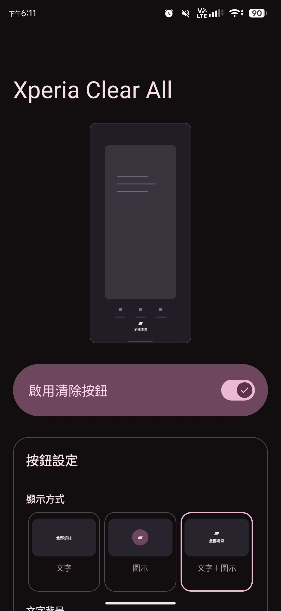
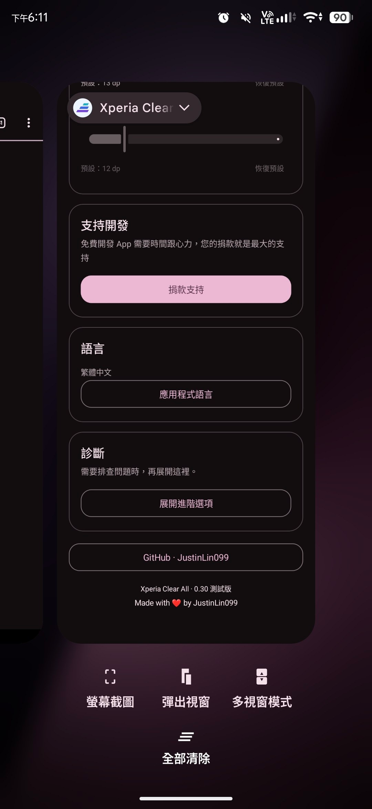
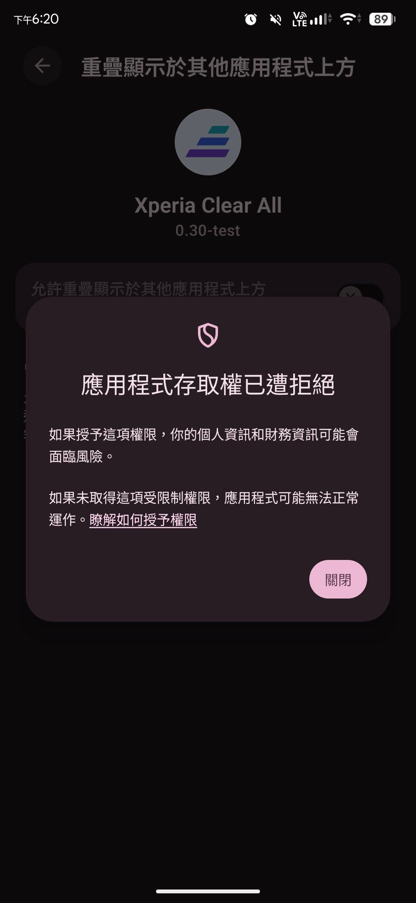
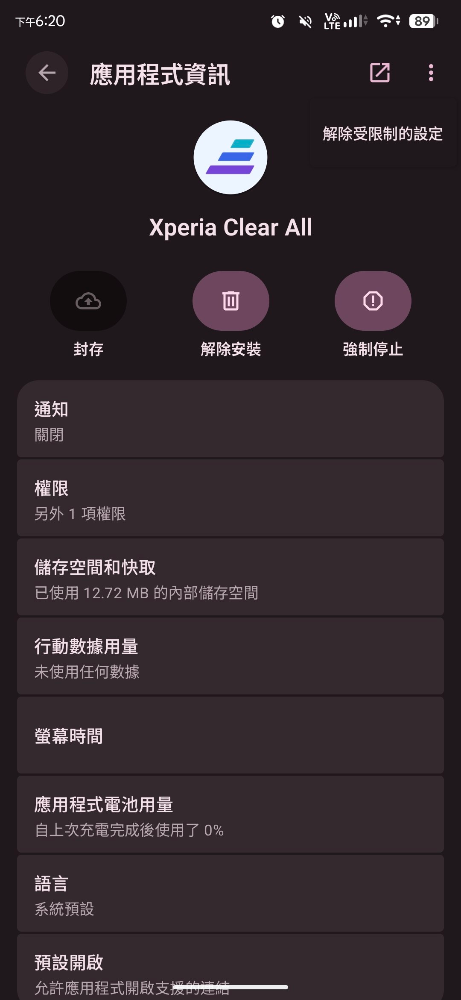

  

<h1 align="center">Xperia Clear All</h1>

  <a href="README.md">繁體中文</a> · <strong>English</strong>

  Bring back the Clear all button removed from Xperia phones after upgrading to Android 17.

  <a href="https://github.com/justinlin099/Xperia_Clear_All/releases"><strong>📥 Download APK</strong></a>
  &nbsp;·&nbsp;
  <a href="#setup">⚙️ First-time setup</a>
  &nbsp;·&nbsp;
  <a href="https://github.com/justinlin099/Xperia_Clear_All/issues">🐛 Report an issue</a>

## 💡 Why this app?

Xperia phones had a Clear all button on Android 16, but it was removed with the Android 17 upgrade.
Xperia Clear All uses Shizuku to restore the button, letting you clear the recent apps list with one tap. No root required.

## 📱 Screenshots

| Main screen | Clear all in Recents |
| :---: | :---: |
|  |  |

## ✨ Features

- The button appears only when Recents is open and contains apps.
- Choose text, an icon, or both. Customize the appearance and position with a live preview.
- Multiple app languages supported.

## 📋 Requirements

- A Sony Xperia phone upgraded to **Android 17**, using the stock Sony launcher.
- [Shizuku 13 or later](https://shizuku.rikka.app/download/) started through wireless debugging (ADB). Root mode is currently unsupported.

> 🎯 **Other Android versions, third-party launchers and phones from other brands have not been tested.**

## 📥 Download and install

Download `Xperia-Clear-All-<version>.apk` from [Releases](https://github.com/justinlin099/Xperia_Clear_All/releases), open it on your phone and follow the installation prompts.

## ⚙️ First-time setup

1. Follow the [official Shizuku guide](https://shizuku.rikka.app/guide/setup/#start-via-wireless-debugging) to pair and start Shizuku.
2. Open Xperia Clear All, tap **Connect Shizuku** and grant access.
3. Tap **Manage overlay permission** and follow the illustrated guide to system settings. Try enabling **Allow display over other apps**. If Android blocks access, follow the steps below to allow restricted settings, then enable the permission again.
4. Follow the app prompts to allow background activity and notifications. If battery usage is set to **Restricted**, change it to **Unrestricted**.
5. Turn on **Enable Clear all**, return to the home screen, then open Recents.

🔓 Android says access is denied?

**First try enabling the permission to trigger the blocked-access message, then allow restricted settings in App info.** Follow these steps in order:

1. Follow the in-app guide to the system permission screen. If an app list appears first, select **Xperia Clear All**. Try enabling the overlay permission, then dismiss the blocked-access message.
2. Return to the app and tap **Open app info**. In the top-right menu, choose **⋮ → Allow restricted settings** and complete any verification requested by Android.
3. Return to the app and tap **Return and allow overlay**. Enable **Allow display over other apps** on the permission screen.

| Access blocked by Android | Allow restricted settings |
| :---: | :---: |
|  |  |

## 🎨 Appearance and position

Customize the button under **Button settings**. To move it, select **Lower right · custom → Adjust position**, then drag it in Recents. Releasing it saves and locks its position. Tapping the button while adjusting it does not clear the list.

## ❓ FAQ

### The button does not appear

Check that Shizuku is connected, the overlay permission is granted, the enable switch is on, and Recents still contains apps. Return to the home screen and open Recents again. If the button is still missing, use the app's diagnostics.

### Do I need to reconnect every time or after restarting my phone?

If your phone remains on Wi-Fi where wireless debugging is available, and both Shizuku and its connection to this app are working, you do not need to pair or connect again. If Shizuku stops or the connection is lost, check Shizuku first, then return to this app and reconnect.

## 🐛 Report an issue

Open an [issue](https://github.com/justinlin099/Xperia_Clear_All/issues) with your phone model, Android version, app version and steps to reproduce the problem.
You can also open **Diagnostics → Show advanced options** in the app, check the connection and copy the results to include in your report.

## ☕ Support development

If you find this tool useful, consider [supporting development](https://buymeacoffee.com/5b32VpsEp5).

## 📄 License and credits

This project is licensed under GNU GPLv3. See [LICENSE](LICENSE) and [NOTICE.txt](NOTICE.txt) for third-party component information.

Thanks to [Shizuku](https://github.com/RikkaApps/Shizuku) and the [Shizuku API](https://github.com/RikkaApps/Shizuku-API).
This is a community project and is not an official Sony app.
