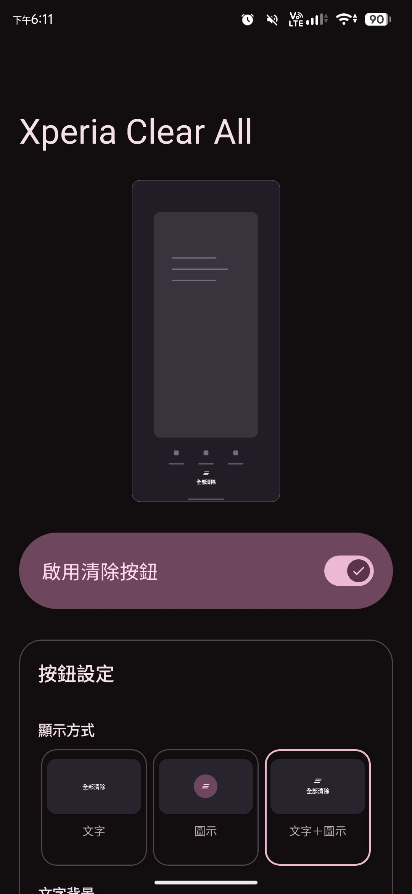
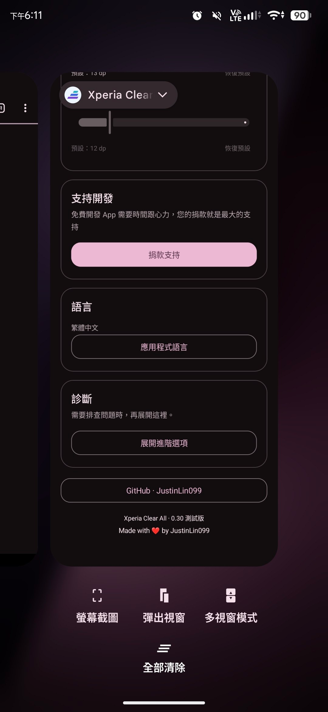
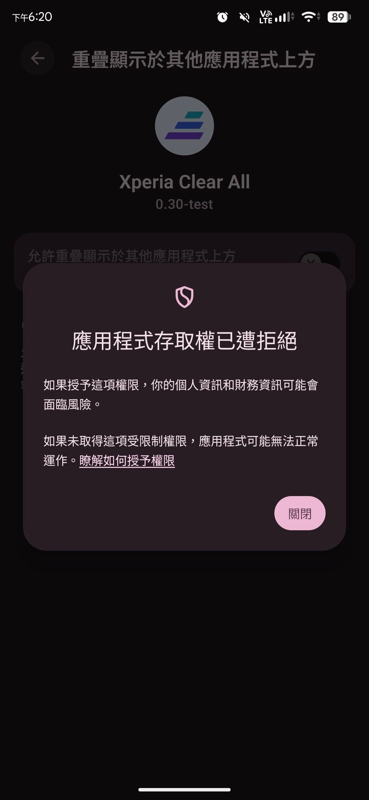
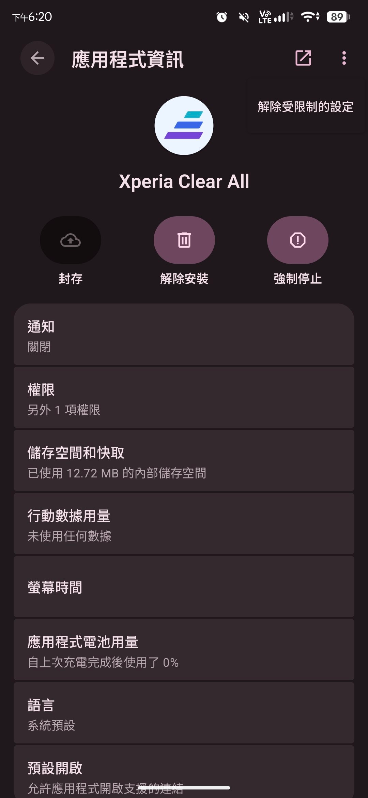

  

<h1 align="center">Xperia Clear All</h1>

  把 Xperia 升級 Android 17 後消失的「全部清除」按鈕補回來。

  <a href="https://github.com/justinlin099/Xperia_Clear_All/releases"><strong>📥 下載 APK</strong></a>
  &nbsp;·&nbsp;
  <a href="#setup">⚙️ 首次設定</a>
  &nbsp;·&nbsp;
  <a href="https://github.com/justinlin099/Xperia_Clear_All/issues">🐛 回報問題</a>

## 💡 為什麼做這個 App？

Xperia 在 Android 16 原本有「全部清除」按鈕，升級 Android 17 後卻移除了。
Xperia Clear All 透過 Shizuku 補回這個按鈕，讓你點一下就能清空最近使用的應用程式清單，不需要 Root。

## 📱 畫面預覽

| App 主畫面 | 多工畫面的「全部清除」 |
| :---: | :---: |
|  |  |

## ✨ 功能

- 按鈕只在多工畫面仍有應用程式時顯示。
- 可選文字、圖示或圖文並用，自訂外觀與位置，並提供即時預覽。
- 支援多語系。

## 📋 使用需求

- 升級至 **Android 17** 的 Sony Xperia 手機，並使用 Sony 原廠桌面。
- [Shizuku 13 或更新版本](https://shizuku.rikka.app/download/)，使用無線偵錯（ADB）模式。目前不支援 Root 模式。

> 🎯 **其他 Android 版本、第三方桌面及其他品牌手機尚未測試。**

## 📥 下載與安裝

從 [Releases](https://github.com/justinlin099/Xperia_Clear_All/releases) 下載 `Xperia-Clear-All-版本.apk`，在手機開啟後依系統提示安裝。

## ⚙️ 首次設定

1. 依照 [Shizuku 官方教學](https://shizuku.rikka.app/guide/setup/#start-via-wireless-debugging) 完成首次配對與啟動。
2. 開啟 Xperia Clear All，點選「連接 Shizuku」並允許授權。
3. 點選「管理顯示權限」，依圖解前往系統設定，嘗試開啟「允許重疊顯示於其他應用程式上方」。若遭拒絕，請依下方圖解解除限制後再允許。
4. 依 App 提示允許背景執行與通知；若電池用量設為「受限制」，請改為「不受限制」。
5. 開啟「啟用清除按鈕」，返回桌面後再進入多工畫面。

🔓 出現「應用程式存取權已遭拒絕」？

**必須先嘗試授權並觸發拒絕提示，再回到應用程式資訊解鎖。** 請依序操作：

1. 依 App 圖解前往系統權限頁面；若先看到應用程式清單，請點選「Xperia Clear All」。嘗試開啟上層顯示，出現「應用程式存取權已遭拒絕」後，點選「關閉」。
2. 回到 App，點選「開啟應用程式資訊」，再選右上角 **⋮ → 解除受限制的設定**，依系統提示完成驗證。
3. 回到 App，點選「返回並允許上層顯示」重新開啟權限頁面，這次再開啟「允許重疊顯示於其他應用程式上方」。

| 系統封鎖權限 | 解除受限制的設定 |
| :---: | :---: |
|  |  |

## 🎨 調整外觀與位置

在「按鈕設定」調整外觀。若要拖曳位置，選擇「右下角・自訂」→「調整位置」，再到多工畫面拖曳；放開後會儲存並鎖定。調整期間輕點按鈕不會清空清單。

## ❓ 常見問題

### 按鈕沒有出現

確認 Shizuku 已連線、上層顯示權限與啟用開關已開啟，而且最近使用清單中仍有應用程式。先回桌面再進入多工畫面；若仍未出現，可使用 App 內的診斷功能。

### 每次使用或重開機後，都要重新連線嗎？

手機仍在可使用無線偵錯的 Wi-Fi 環境中，且 Shizuku 與本 App 的連線正常時，不需要重新配對或連線。只有 Shizuku 未執行或連線中斷時，才需開啟 Shizuku 檢查，再回到本 App 連接。

## 🐛 回報問題

請在 [Issues](https://github.com/justinlin099/Xperia_Clear_All/issues) 附上機型、Android／App 版本及重現步驟。
也可在 App 的「診斷」→「展開進階選項」檢查連線並複製結果，一併附上。

## ☕ 贊助開發

覺得這個工具實用，歡迎 [贊助開發](https://buymeacoffee.com/5b32VpsEp5)。

## 📄 授權與致謝

本專案採用 GNU GPLv3，詳見 [LICENSE](LICENSE)。第三方元件資訊請參閱 [NOTICE.txt](NOTICE.txt)。

感謝 [Shizuku](https://github.com/RikkaApps/Shizuku) 與 [Shizuku API](https://github.com/RikkaApps/Shizuku-API)。
本專案為社群工具，非 Sony 官方應用程式。
